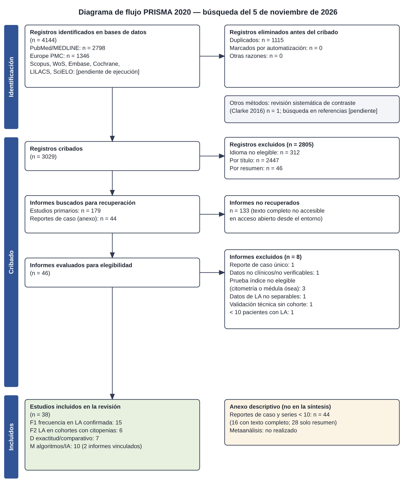

# Biometría hemática y frotis de sangre periférica en la sospecha temprana de leucemia aguda: revisión sistemática

**Autoría:** revisión elaborada con asistencia de inteligencia artificial (Claude, Anthropic) para un ejercicio académico comparativo. La responsabilidad de la verificación final corresponde a la investigadora.
**Fecha de la búsqueda:** 5 de noviembre de 2026.
**Registro:** no registrada (PROSPERO/OSF).

---

## Resumen estructurado

**Introducción.** La biometría hemática (BH) y el frotis de sangre periférica (FSP) son las primeras pruebas que orientan hacia una leucemia aguda (LA). Sin embargo, la literatura suele confundir la frecuencia de sus alteraciones en pacientes ya diagnosticados con su capacidad para distinguir la LA de otras enfermedades.

**Objetivo.** Analizar sistemáticamente la evidencia sobre la utilidad de la BH y del FSP para identificar alteraciones sugestivas de LA, linfoblástica (LLA) y mieloide (LMA), y contribuir a su sospecha temprana.

**Métodos.** Revisión sistemática conforme a PRISMA 2020.
- **Fuentes ejecutadas:** PubMed/MEDLINE y Europe PMC, el 5 de noviembre de 2026, sin límite de fecha.
- **Fuentes no ejecutadas por falta de acceso:** Scopus, Web of Science, Embase, Cochrane, LILACS y SciELO. Sus ecuaciones se entregan en el anexo.
- **Elegibilidad:** estudios observacionales, diagnósticos y series de ≥10 pacientes con datos de la BH o del FSP al diagnóstico. Los reportes de caso se analizaron en un anexo descriptivo separado.
- **Riesgo de sesgo:** lista JBI de prevalencia y QUADAS-2.
- **Síntesis:** narrativa estructurada (SWiM). El metaanálisis no fue viable por la heterogeneidad de diseños y umbrales.

**Resultados.**
- De 4144 registros identificados se cribaron 3029. Ciento setenta y nueve informes requerían el texto completo, pero 133 (74 %) no pudieron recuperarse. Se incluyeron 38 estudios: 15 de frecuencia en LA confirmada, 6 de LA en cohortes con citopenias, 7 comparativos o diagnósticos y 10 de algoritmos o inteligencia artificial.
- En la LLA infantil predominaron la anemia (83 %) y la trombocitopenia (83 %), mientras que el recuento leucocitario se repartió casi por tercios entre leucopenia, valores normales y leucocitosis.
- Entre el 10 % y el 20 % de los niños con LA no tenía blastos circulantes al diagnóstico. Aun así, casi el 90 % de ellos presentaba alguna citopenia, y una BH completamente normal fue excepcional (1–2 %).
- En los niños con síntomas osteoarticulares sin blastos, la neutropenia y la trombocitopenia fueron los hallazgos que más diferenciaron la LLA de la artritis idiopática juvenil. Estos estudios tienen alto riesgo de sesgo de espectro.
- Los modelos de inteligencia artificial publicaron áreas bajo la curva de 0,74 a 0,999, pero solo uno se evaluó de forma prospectiva en pacientes con sospecha clínica.
- Ningún estudio procedía del primer nivel de atención.

**Conclusiones.**
- La BH es casi siempre anormal en la LA. La alteración que más orienta es la citopenia, sobre todo cuando afecta a varias series, y no la leucocitosis.
- La ausencia de blastos en el frotis no excluye la enfermedad.
- La evidencia sobre exactitud diagnóstica es escasa y de certeza muy baja. Ninguna de estas pruebas sustituye a la confirmación por médula ósea, inmunofenotipo y estudios genéticos.

**Palabras clave:** leucemia aguda; leucemia linfoblástica aguda; leucemia mieloide aguda; biometría hemática; recuento sanguíneo completo; frotis de sangre periférica; blastos; diagnóstico temprano; revisión sistemática.

---

## 1. Introducción

La leucemia es el cáncer más frecuente de la infancia: supone aproximadamente un tercio de los casos pediátricos [1]. Su presentación clínica es tan variada que una revisión sistemática de 33 estudios encontró que solo cinco signos aparecían en más de la mitad de los niños, y que un 6 % estaba asintomático al diagnóstico [1]. En los adultos, la LMA predomina y suele confundirse al principio con infecciones o con anemias carenciales.

La confirmación diagnóstica exige el estudio de la médula ósea con inmunofenotipo y caracterización genética, según la quinta edición de la clasificación de la OMS y la Clasificación de Consenso Internacional [2-4]. Antes de llegar a esas pruebas, sin embargo, casi todo paciente pasa por una BH y, con frecuencia, por un FSP. Esas pruebas, baratas y disponibles en cualquier nivel asistencial, determinan si la sospecha nace o se pierde.

La literatura sobre el tema es abundante pero desigual. Muchos trabajos describen la BH de pacientes ya diagnosticados en centros de referencia y presentan esas frecuencias como si midieran capacidad diagnóstica. Que la mayoría de los niños con LLA tenga anemia no dice cuántos niños con anemia tienen LLA. Esta revisión separa ambas preguntas desde el protocolo.

## 2. Justificación

Una revisión que reúna y valore críticamente lo que la BH y el FSP pueden y no pueden aportar a la sospecha temprana tiene utilidad práctica por tres razones:

1. **Atención primaria y urgencias.** Ahí se interpreta la mayoría de las BH, a menudo sin hematólogo.
2. **Presentaciones engañosas.** Las formas sin blastos circulantes, con recuentos casi normales o con dolor osteoarticular retrasan el diagnóstico.
3. **Nuevas tecnologías.** Han aparecido analizadores con parámetros de población celular y modelos de inteligencia artificial cuya validez real conviene situar en contexto.

## 3. Objetivos

**General.** Analizar sistemáticamente la evidencia sobre la utilidad de la BH y del FSP para identificar alteraciones sugestivas de LA (LLA y LMA) y contribuir a su sospecha temprana.

**Específicos.**
1. Describir la frecuencia de las alteraciones de la BH (leucocitosis, leucopenia, anemia, trombocitopenia, neutropenia, citopenias combinadas) al diagnóstico.
2. Describir los hallazgos del FSP, con especial atención a la ausencia de blastos circulantes.
3. Sintetizar las medidas de exactitud diagnóstica disponibles.
4. Valorar el riesgo de sesgo y la aplicabilidad al primer nivel de atención.
5. Identificar vacíos de conocimiento.

## 4. Metodología

**Diseño y protocolo.** La revisión siguió PRISMA 2020 [5], con elementos de PRISMA-S para la búsqueda [6] y de PRISMA-DTA para los aspectos diagnósticos [7]. El protocolo se elaboró antes del cribado (Etapa 1) y no se registró.

**Pregunta (PIRD).**
- **P:** pacientes de cualquier edad con LA al diagnóstico, o con sospecha de enfermedad hematológica.
- **I:** BH (incluidas las alertas y los parámetros del analizador) y FSP.
- **R:** médula ósea con inmunofenotipo y/o genética según FAB, OMS o ICC.
- **D:** frecuencia de las alteraciones y medidas de exactitud.

**Criterios de elegibilidad.**
- **Se incluyeron:** estudios observacionales o diagnósticos y series de ≥10 pacientes; en inglés, español o portugués; sin límite de fecha.
- **Se excluyeron:**
  - Estudios de leucemias crónicas o de la fase blástica de la LMC.
  - Estudios de recaída o de seguimiento.
  - Estudios cuya prueba índice se realizaba en médula ósea o en otros líquidos.
  - Estudios cuyos datos de LA no podían separarse de otras neoplasias.
  - Revisiones narrativas.
- **Reportes de caso:** se registraron en un anexo descriptivo. Solo prueban que una presentación es posible, no su frecuencia.
- **Revisiones sistemáticas previas:** se usaron como contraste y no como evidencia independiente.

**Fuentes y búsqueda.**
- **Ejecutadas el 5 de noviembre de 2026:**
  - PubMed: tres bloques combinados con AND (leucemia aguda; BH o frotis; presentación, diagnóstico o sospecha), con MeSH y texto libre. La ecuación se amplió tras una prueba de sensibilidad sobre 200 títulos excluidos y recuperó 2798 registros.
  - Europe PMC: solo términos de título y resumen (1346 registros).
- **No ejecutadas por falta de acceso:** Scopus, Web of Science, Embase y Cochrane (suscripción), y LILACS y SciELO (sus portales bloquean las consultas automatizadas). Sus ecuaciones se entregan en el anexo A como pendientes.

**Selección.**
- Deduplicación por PMID, DOI y título normalizado.
- Exclusión por idioma a partir de los metadatos.
- Cribado de títulos y de resúmenes, y evaluación del texto completo, por un único revisor, con razones registradas.
- Textos completos obtenidos únicamente de Europe PMC y PMC, en acceso abierto.

**Extracción y riesgo de sesgo.**
- Matriz de 17 campos, con anotación del origen de cada dato.
- Riesgo de sesgo con la lista JBI de prevalencia [8] para los estudios de frecuencia, y con QUADAS-2 [9] para los estudios diagnósticos y los modelos de IA.

**Síntesis.**
- Se predefinió el metaanálisis de proporciones con ≥5 estudios comparables, y el de exactitud con ≥4 estudios con un umbral común.
- Ninguno se cumplió, por lo que se aplicó la guía SWiM [10] con agrupación por pregunta, tipo de leucemia y edad.
- La certeza se juzgó de forma estructurada, siguiendo la lógica GRADE.

## 5. Estrategia de búsqueda

Las ecuaciones exactas, con sus recuentos por bloque, la prueba de sensibilidad y las ecuaciones pendientes para las demás bases, están en el anexo A y en el documento de la Etapa 2.

**Sensibilidad de la búsqueda.** La estrategia no recuperó la revisión sistemática de Clarke y colaboradores sobre la presentación clínica de la leucemia infantil [1]. Esa revisión no menciona términos de la BH en su título ni en su resumen. Por ello, la búsqueda puede haber perdido estudios de «características de presentación» que solo informan de la BH en sus tablas.

## 6. Resultados del proceso de selección (PRISMA)

**Identificación y cribado.**
- Se identificaron 4144 registros (PubMed 2798; Europe PMC 1346) y se eliminaron 1115 duplicados.
- De los 3029 registros cribados se excluyeron 312 por idioma, 2447 por título y 46 en el resumen.

**Texto completo.**
- Se buscaron 179 informes, pero 133 no pudieron recuperarse: la mayoría anteriores a 2010 y publicados en plataformas editoriales no accesibles.
- De los 46 evaluados, se excluyeron 8:
  - Reporte de caso único: 1.
  - Datos no clínicos o no verificables: 1.
  - Prueba índice no elegible: 3.
  - Datos no separables: 1.
  - Validación técnica sin cohorte: 1.
  - Menos de 10 pacientes con LA: 1.

**Resultado final.**
- **Estudios incluidos: 38.**
- **Anexo de reportes de caso:** 44.

El diagrama de flujo está en `diagrama_prisma.svg` (anexo B).

## 7. Características de los estudios incluidos

**Distribución.**
- Los 38 estudios se publicaron entre 2013 y 2026; 28 de ellos en 2020 o después.
- Proceden de 17 países, con predominio de India (8), Pakistán (6) y China (5). Solo dos son latinoamericanos, ambos de México [11,12].
- Todos son observacionales y casi todos retrospectivos. Treinta y siete se hicieron en hospitales terciarios o de referencia; ninguno en atención primaria.

**Agrupación por pregunta.**
- **Frecuencia de alteraciones en LA confirmada (F1, n = 15)** [11,13-26].
- **Proporción de LA en cohortes con citopenias (F2, n = 6)** [27-32].
- **Comparación con un grupo sin LA o exactitud diagnóstica (D, n = 7)** [12,33-38].
- **Algoritmos o inteligencia artificial sobre la BH o el frotis (M, n = 10)** [39-48].

**Cohortes con posible solapamiento.** Los dos trabajos de Haider proceden del mismo instituto y de periodos superpuestos [46,48]. Se interpretan como un único cuerpo de evidencia.

La matriz completa de 17 campos está en el anexo C.

## 8. Evaluación del riesgo de sesgo

**Estudios de frecuencia (JBI).**
- Grupo F1: 4 con riesgo bajo, 2 bajo-moderado, 5 moderado y 4 alto.
  - Riesgo bajo: los de mayor tamaño y con pacientes consecutivos [11,19,22] y una cohorte nacional danesa [16].
  - Riesgo alto: estudios con incoherencias internas, selección no consecutiva o datos parciales [17,18,21,26].
- Grupo F2: 4 con riesgo moderado y 2 alto. Todas las cohortes F2 comparten un sesgo de verificación, porque solo incluyen a pacientes con citopenia remitidos a estudio de médula.

**Estudios diagnósticos y modelos (QUADAS-2).** El riesgo de sesgo fue alto en 16 de los 17. Los motivos:
- **Diseño de «dos puertas».** Los estudios que comparan LLA con artritis idiopática juvenil reclutan cada grupo por separado y aplican estándares de referencia distintos: médula para la LLA y criterios clínicos ILAR para la AIJ [12,34-36,38].
- **Controles poco representativos.** Varios modelos de IA usan controles sanos o de centros oncológicos.
- **Ausencia de validación independiente.** Varios umbrales y modelos se ajustaron y evaluaron en la misma muestra.

La única excepción, con riesgo bajo-moderado, fue un estudio prospectivo de pacientes consecutivos que acudieron a urgencias con hemorragia [44].

La aplicabilidad al primer nivel de atención fue baja en todos los estudios.

## 9. Resultados hematológicos

### 9.1 Biometría hemática

**Anemia.**
- Fue la alteración más constante. En 203 niños mexicanos con LLA-B consecutivos, el 82,9 % tenía hemoglobina <11 g/dL (mediana 7,5 g/dL) [11].
- En una cohorte tailandesa de 1042 niños con LA, la mediana fue de 7,0 g/dL [20].
- En la LMA, en series mayoritariamente adultas, las medias se situaron en torno a 8 g/dL [23,39,46].
- En una serie india, el 35 % de las LMA y de las LLA-B tenía anemia grave (<7 g/dL) [14].

**Trombocitopenia.**
- Tuvo una frecuencia similar a la anemia: 82,9 % <150×10⁹/L en la LLA infantil [11] y 81,9 % <100×10⁹/L en la cohorte tailandesa, con una mediana de 38×10⁹/L [20].
- En la serie india, la trombocitopenia grave (<50×10⁹/L) afectó al 92–95 % de las LA [14].
- Una minoría conservó plaquetas normales: el 16 % en la LLA infantil [11].
- El recuento automatizado puede sobrestimar las plaquetas: en el 26 % de las LA hiperleucocitarias, los fragmentos de blastos se contaron como plaquetas, sobre todo en la LMA-M5 y M1. El canal fluorescente tampoco eliminó del todo el error [15].

**Leucocitos.**
- Fue el parámetro menos predecible. En la LLA infantil se repartieron casi por tercios: 36,6 % con leucocitosis (>14 500/µL), 36,1 % con leucopenia (<4500/µL) y 25,4 % con recuento normal [11].
- Las medianas pediátricas oscilaron entre 7,1 y 10,7×10⁹/L [11,19,22], muy lejos de la imagen clásica de «leucocitosis con blastos».
- En la LMA, en series mayoritariamente adultas, las medias fueron más altas (≈40–57×10⁹/L), con dispersión muy amplia [23,39,46].
- En una serie india ninguna LMA ni LLA superó los 100×10⁹/L; sí lo hizo 1 de los 3 casos de LA de fenotipo mixto [14].
- Una publicación que afirmaba hiperleucocitosis en todos sus casos contradecía sus propias medias y no se utilizó [21].

**Neutropenia.**
- En los niños con LLA sin blastos periféricos, el 76,2 % tenía neutropenia (<1,5×10⁹/L) [19].
- En las series de LLA con artritis, la neutropenia afectó al 65 % (<1,0×10⁹/L) [35] y al 92 % (<1,5×10⁹/L) [12].

**Combinaciones y presentaciones atípicas.**
- La afectación de varias series fue la regla. En la cohorte mexicana, el 70,9 % tenía anemia y trombocitopenia combinadas, con leucocitosis, con leucopenia o con leucocitos normales; solo el 10,8 % tenía una única serie alterada y el 1 % (2 niños) una BH normal [11].
- En la cohorte de St. Jude, 18 de los 147 niños sin blastos periféricos (1,8 % de los 1003) tenían además una BH normal al diagnóstico. Casi todos presentaban adenopatías, una masa mediastínica o dolor óseo [19].
- En la leucemia eritroide aguda, la pancitopenia fue la forma de presentación en el 81 % [25].
- La afectación musculoesquelética se asoció a una BH menos alterada: hemoglobina 8,0 frente a 7,0 g/dL; plaquetas 78 frente a 36×10⁹/L; leucocitos 9,0 frente a 18,1×10⁹/L. El 2,5 % de estos niños tenía una BH normal y sin blastos [20].
- En la LMA infantil danesa, el 29 % presentó síntomas musculoesqueléticos y el 8 % recibió primero un diagnóstico osteomuscular erróneo [16].

**La LA vista desde las citopenias (F2).**
- Entre los niños con pancitopenia estudiados con médula, la LA representó entre el 17,4 % y el 26,2 % [29,30]. Otro estudio pediátrico informó de un 23,9 % de «leucemias», sin separar las agudas [31].
- En adultos, la LMA explicó el 27,4 % de las pancitopenias [32].
- La LA fue la primera causa de trombocitopenia (28 %) en una cohorte remitida a médula [27], pero solo el 4,4 % de una cohorte etíope con parámetros anormales diversos [28].
- Las cifras dependen de quién llega a la médula. No pueden trasladarse a una población no seleccionada.

### 9.2 Frotis de sangre periférica

**Blastos circulantes.**
- Su ausencia no es rara. En la cohorte de St. Jude, el 14,7 % de 1003 niños con LLA tenía <1 % de blastos en sangre periférica [19].
- En la cohorte tailandesa no había blastos en el 10,2 % de 1041 niños con LA [20], y en una cohorte china en el 20,4 % de 367 niños con LLA [22].
- La ausencia fue más frecuente en la LLA-B que en la LLA-T [19,22] y en los niños con presentación musculoesquelética (17,3 % frente a 9,6 %) [20].
- En estos niños la BH rara vez era normal: el 87,8 % tenía al menos una citopenia [19].

**El frotis en la pancitopenia.** La sensibilidad del frotis cae cuando hay pancitopenia. En una serie de LLA infantil se observaron blastos en el frotis en el 27 % de los niños con pancitopenia, frente al 64 % de los que no la tenían. Además, el 10 % de los primeros se interpretó inicialmente como aplasia [26].

**Morfología y linaje.**
- La morfología concordó con la citometría de flujo en el 89–90 % de los casos (κ = 0,79) [13,23]. Sin embargo, el linaje se reclasificó en hasta 1 de cada 10 casos.
- Ningún rasgo morfológico permitió reconocer la LA de fenotipo mixto. En esa serie, 14 de 15 pacientes tenía blastos circulantes, pero la mayoría se clasificó como LMA [24].
- En la leucemia promielocítica aguda (LPA), los blastos periféricos pueden ser escasos y predominan los promielocitos anómalos (mediana 72,5 %) [37].

**Variabilidad del observador.**
- Ningún estudio clínico midió directamente la concordancia entre microscopistas en la detección de blastos. La evidencia disponible es indirecta.
- Cuatro patólogos que buscaban promielocitos anómalos en el frotis obtuvieron áreas bajo la curva de 0,78 a 0,81, por debajo de un modelo de aprendizaje profundo [42].
- Diez hematólogos y oncólogos expertos no superaron a otro modelo al distinguir la LPA de otras LMA [47].

**Analizador frente a microscopio.**
- El escatergrama «gris» del analizador concordó solo moderadamente con el recuento microscópico de blastos (κ = 0,527). El 16 % de los pacientes con ≥35,5 % de blastos no mostró ese patrón [33].
- Los estudios clásicos sobre las alertas de blastos de los analizadores estaban entre los informes no recuperados.

### 9.3 Exactitud diagnóstica y comparación con enfermedades que simulan una LA

Cinco estudios compararon niños con LLA y niños con artritis idiopática juvenil (AIJ), casi siempre en ausencia de blastos periféricos [12,34-36,38].

**Neutropenia.** Fue el hallazgo más discriminante en todos ellos:
- Neutrófilos anormales: sensibilidad 52,5 %, especificidad 96,7 %, cociente de probabilidad positivo 15,9 [38].
- Neutropenia <1,0×10⁹/L: OR 129 [35].
- Neutropenia <1,5×10⁹/L: 92 % frente a 0 % [12].
- Neutrófilos <2×10⁹/L: OR 50 [36].

**Otros parámetros.**
- La trombocitopenia tuvo una fuerza parecida: OR 128 con <100×10⁹/L [35]. Incluso plaquetas <300×10⁹/L se asociaron a LLA (OR 14) [36].
- La hemoglobina baja fue menos específica: cociente de probabilidad positivo 6,6 [38].
- El recuento leucocitario no discriminó [34,38].

**Número de series afectadas.** Contar cuántas series estaban disminuidas resumió bien la información. El riesgo estimado de LLA fue del 0,2 % con recuentos normales y del 9 %, 67 % y 100 % con una, dos o tres series afectadas [35].

**Interpretación.** Todas estas cifras proceden de diseños de dos grupos, con prevalencias artificiales y verificación diferencial. Indican dirección y magnitud relativa, no rendimiento en la práctica.

Fuera de este contexto, un estudio pequeño encontró que los parámetros de población celular del analizador distinguían la LPA de otras LMA (sensibilidad 90 %, especificidad 67 % para NE-SFL), con umbrales derivados en la misma muestra [37].

### 9.4 Algoritmos e inteligencia artificial

**Rendimiento publicado.** Los diez estudios publicaron áreas bajo la curva de 0,74 a 0,999. Hubo modelos para:
- Detectar la LMA a partir de la BH [39].
- Clasificar neoplasias en pacientes con leucocitosis [40].
- Cribar la LPA con parámetros del analizador [43,48] o con imágenes del frotis [42,44,45,47].
- Diagnosticar la LA a partir de frotis digitalizados completos [41].
- Diferenciar tipos de leucemia [46].

**Cautelas.**
- Solo un estudio fue prospectivo en pacientes con sospecha clínica real: el analizador digital MC-100i, en urgencias, alcanzó una sensibilidad del 95,8 % y una especificidad del 100 % para el cribado de la LPA [44]. Aun así, su sensibilidad celular para los promielocitos anómalos fue solo del 62,8 % antes de la corrección humana.
- La exactitud de un modelo basado solo en la BH cayó del 96,4 % al 80 % en la validación temporal [39].
- Uno de los estudios con mejor rendimiento tiene como coautor a personal del fabricante del analizador [43].
- Ninguno se evaluó en atención primaria.

## 10. Discusión crítica

**Lo que muestra la evidencia sobre la BH.** La BH es casi siempre anormal en la LA. Lo que la alerta, sin embargo, son las citopenias, sobre todo cuando se combinan, y no la leucocitosis. La imagen de un niño con «muchos glóbulos blancos y blastos» describe solo a una parte de los casos: en la cohorte mexicana, tantos niños tenían leucopenia como leucocitosis [11].

**Coherencia con otras fuentes.**
- Los datos de BH de este conjunto coinciden con la tendencia de los estudios pediátricos de mayor tamaño [19,20,22].
- También complementan la revisión de Clarke y colaboradores, que se centró en signos y síntomas: hepatomegalia en el 64 %, esplenomegalia en el 61 %, palidez en el 54 % [1]. La suma de la clínica y de la BH es lo que convierte una sospecha difusa en una indicación de estudio.

**Lo que muestra la evidencia sobre el frotis.**
- La aportación del frotis es doble. Cuando hay blastos, convierte la sospecha en urgencia. Cuando no los hay, no tranquiliza: entre uno de cada diez y uno de cada cinco niños con LA no tiene blastos circulantes [19,20,22].
- La ausencia de blastos es especialmente probable en la LLA-B con recuentos bajos y en las presentaciones osteoarticulares.
- El frotis tiene también un valor menos conocido: detectar artefactos del analizador, como las pseudoplaquetas, que pueden enmascarar una trombocitopenia grave [15].
- Su principal limitación es humana. La variabilidad entre observadores, medida en estudios de inteligencia artificial, fue considerable incluso entre especialistas [42,47].

**Contradicciones aparentes.**
- La proporción de LA entre las citopenias varió del 4,4 % al 28 % [27,28]. La diferencia se explica menos por la biología que por los criterios de derivación a médula.
- La exactitud «casi perfecta» de varios modelos contrasta con la caída que se observa cuando se validan fuera de su muestra de origen [39]. Es un patrón conocido de sobreajuste y de sesgo de espectro.

**Asociación frente a capacidad diagnóstica.** Las OR muy altas de la neutropenia y la trombocitopenia en la comparación LLA frente a AIJ son asociaciones en poblaciones seleccionadas. No equivalen a una sensibilidad y especificidad aplicables a todos los niños con dolor articular.

**Certeza de la evidencia (juicio estructurado).**
- **Moderada-baja.** La LLA infantil suele presentarse con anemia y trombocitopenia, con leucocitos variables. Los datos son consistentes y proceden de cohortes grandes, pero todas son de referencia.
- **Moderada-baja.** Entre el 10 % y el 20 % de los niños con LA no tiene blastos circulantes, por motivos similares.
- **Muy baja.** La exactitud de la neutropenia y la trombocitopenia frente a la AIJ: diseño de dos grupos, imprecisión y umbrales heterogéneos.
- **Muy baja.** El rendimiento de los modelos de inteligencia artificial en la práctica: espectro, falta de validación externa y aplicabilidad.
- **Muy baja o ausente.** Cualquier afirmación sobre adultos en atención primaria.

## 11. Limitaciones

1. **Acceso limitado.**
   - No se pudieron consultar seis de las ocho bases previstas. Faltan sobre todo LILACS y SciELO, las fuentes principales de la literatura latinoamericana en español y portugués.
   - El 74 % de los informes potencialmente elegibles no pudo recuperarse en texto completo, entre ellos estudios clásicos sobre las alertas de los analizadores, la LA con plaquetas normales y los criterios automatizados de revisión del frotis.
   - El resultado es una muestra sesgada hacia la literatura reciente, de acceso abierto y de Asia meridional y China.
2. **Un único revisor.** Cribado, extracción y evaluación los hizo un solo revisor (un sistema de inteligencia artificial), sin doble revisión independiente ni cálculo de concordancia.
3. **Sensibilidad de la búsqueda.** El bloque de presentación clínica y la dependencia de que los términos de la BH aparezcan en el título o el resumen redujeron la sensibilidad. La búsqueda en las referencias está pendiente.
4. **Calidad de la evidencia.** Todos los estudios son de hospitales de referencia, casi todos retrospectivos, con umbrales heterogéneos y, en varios casos, con errores de informe.
5. **Sin metaanálisis.** La heterogeneidad impidió combinar los datos. Los rangos presentados no son estimaciones combinadas.
6. **Material suplementario y anexo.** No se consultó el material suplementario. Los reportes de caso del anexo no se evaluaron con la lista JBI.

## 12. Implicaciones para el diagnóstico temprano

Estas implicaciones derivan de la evidencia revisada y de sus límites. No son una guía clínica.

1. **Leer la BH por series.** La anemia y la trombocitopenia combinadas, o la afectación de tres series, justifican revisar el frotis y derivar sin demora aunque los leucocitos sean normales o bajos [11,35].
2. **Un frotis sin blastos no descarta la LA.** Ante citopenias inexplicadas, visceromegalias, adenopatías o dolor óseo, la ausencia de blastos no excluye la enfermedad [19,20].
3. **Dolor osteoarticular con citopenias.** En un niño con dolor osteoarticular persistente, la neutropenia o la trombocitopenia, aunque sean leves, deben alertar antes de etiquetar una artritis o pautar corticoides [12,35,36].
4. **Revisar el frotis ante cifras discordantes.** Si las plaquetas del analizador no concuerdan con el cuadro clínico, sobre todo en LA hiperleucocitarias, conviene revisar el frotis [15].
5. **La IA, de momento, en investigación.** Las herramientas de inteligencia artificial no deberían incorporarse a la sospecha en atención primaria sin validación prospectiva en ese entorno.
6. **La confirmación sigue siendo especializada.** Requiere médula ósea, inmunofenotipo y genética [2-4]. La BH y el frotis abren la puerta, pero no la cierran.

## 13. Conclusiones

- En los estudios disponibles, la BH fue casi siempre anormal al diagnóstico de la LA, con un patrón dominado por la anemia y la trombocitopenia y un recuento leucocitario muy variable.
- El FSP aporta la observación de blastos, pero en una proporción no despreciable de niños están ausentes, y entonces son las citopenias las que sostienen la sospecha.
- Las medidas de exactitud diagnóstica proceden de estudios con alto riesgo de sesgo y no permiten fijar umbrales para la práctica.
- Existe un vacío de evidencia en el primer nivel de atención, en adultos y en Latinoamérica.
- Estas conclusiones se basan en 38 estudios de acceso abierto y deben revisarse cuando se incorporen los informes y las bases pendientes.

## 14. Declaración sobre el uso de inteligencia artificial

La búsqueda, el cribado, la extracción, la evaluación del riesgo de sesgo y la redacción las realizó un modelo de lenguaje (Claude, Anthropic), con acceso a PubMed y Europe PMC desde un entorno de ejecución. Todas las referencias se verificaron en PubMed. Los datos se extrajeron del texto completo de acceso abierto, y las decisiones se registraron en archivos auditables. Ningún resultado se generó sin una fuente identificable.

## Referencias

1. Clarke RT, Van den Bruel A, Bankhead C, Mitchell CD, Phillips B, Thompson MJ. Clinical presentation of childhood leukaemia: a systematic review and meta-analysis. Arch Dis Child. 2016;101(10):894-901. doi:10.1136/archdischild-2016-311251. PMID: 27647842.
2. Khoury JD, Solary E, Abla O, Akkari Y, Alaggio R, Apperley JF, et al. The 5th edition of the World Health Organization Classification of Haematolymphoid Tumours: Myeloid and Histiocytic/Dendritic Neoplasms. Leukemia. 2022;36(7):1703-1719. doi:10.1038/s41375-022-01613-1. PMID: 35732831.
3. Alaggio R, Amador C, Anagnostopoulos I, Attygalle AD, Araujo IBO, Berti E, et al. The 5th edition of the World Health Organization Classification of Haematolymphoid Tumours: Lymphoid Neoplasms. Leukemia. 2022;36(7):1720-1748. doi:10.1038/s41375-022-01620-2. PMID: 35732829.
4. Arber DA, Orazi A, Hasserjian RP, Borowitz MJ, Calvo KR, Kvasnicka HM, et al. International Consensus Classification of Myeloid Neoplasms and Acute Leukemias: integrating morphologic, clinical, and genomic data. Blood. 2022;140(11):1200-1228. doi:10.1182/blood.2022015850. PMID: 35767897.
5. Page MJ, McKenzie JE, Bossuyt PM, Boutron I, Hoffmann TC, Mulrow CD, et al. The PRISMA 2020 statement: an updated guideline for reporting systematic reviews. BMJ. 2021;372:n71. doi:10.1136/bmj.n71. PMID: 33782057.
6. Rethlefsen ML, Kirtley S, Waffenschmidt S, Ayala AP, Moher D, Page MJ, et al. PRISMA-S: an extension to the PRISMA Statement for Reporting Literature Searches in Systematic Reviews. Syst Rev. 2021;10(1):39. doi:10.1186/s13643-020-01542-z. PMID: 33499930.
7. McInnes MDF, Moher D, Thombs BD, McGrath TA, Bossuyt PM, Clifford T, et al. Preferred Reporting Items for a Systematic Review and Meta-analysis of Diagnostic Test Accuracy Studies: The PRISMA-DTA Statement. JAMA. 2018;319(4):388-396. doi:10.1001/jama.2017.19163. PMID: 29362800.
8. Munn Z, Moola S, Lisy K, Riitano D, Tufanaru C. Methodological guidance for systematic reviews of observational epidemiological studies reporting prevalence and cumulative incidence data. Int J Evid Based Healthc. 2015;13(3):147-53. doi:10.1097/XEB.0000000000000054. PMID: 26317388.
9. Whiting PF, Rutjes AW, Westwood ME, Mallett S, Deeks JJ, Reitsma JB, et al. QUADAS-2: a revised tool for the quality assessment of diagnostic accuracy studies. Ann Intern Med. 2011;155(8):529-36. doi:10.7326/0003-4819-155-8-201110180-00009. PMID: 22007046.
10. Campbell M, McKenzie JE, Sowden A, Katikireddi SV, Brennan SE, Ellis S, et al. Synthesis without meta-analysis (SWiM) in systematic reviews: reporting guideline. BMJ. 2020;368:l6890. doi:10.1136/bmj.l6890. PMID: 31948937.
11. Jaime-Perez JC, Garcia-Arellano G, Herrera-Garza JL, Marfil-Rivera LJ, Gomez-Almaguer D. Revisiting the complete blood count and clinical findings at diagnosis of childhood acute lymphoblastic leukemia: 10-year experience at a single center. Hematol Transfus Cell Ther. 2019;41(1):57-61. doi:10.1016/j.htct.2018.05.010. PMID: 30793106.
12. Torres Jimenez AR, Solis Vallejo E, Cespedes Cruz AI, Ramirez Miramontes JV, Cortina Olvera GDC, Velazquez Cruz A, et al. Differences between leukemic arthritis and juvenile idiopathic arthritis. Pediatr Rheumatol Online J. 2023;21(1):50. doi:10.1186/s12969-023-00836-5. PMID: 37259088.
13. Al-Aghbri SMA, Al-Nood HA, Al-Haidary NM, Balkam FA. Integrating immunophenotyping and morphology in the diagnosis of acute leukemia at the National Oncology Center, Sana'a, Yemen. Libyan J Med. 2026;21(1):2735579. doi:10.1080/19932820.2026.2735579. PMID: 42762201.
14. Shome A, Paswan MK, Jamaiyar A, Shome A. Clinico-Hematological and Immunophenotypic Profile of Leukemia Patients at a Tertiary Care Center in Jharkhand, India: A Cross-Sectional Study. Cureus. 2026;18(4):e107063. doi:10.7759/cureus.107063. PMID: 42147558.
15. Bobee V, Ravel-Chapuis R, Souissi M, Boutet C, Bigot D, Paquin C, et al. Overestimation of Automated Platelet Counts by Blast Fragments in Acute Hypercellular Leukemias: A Retrospective Study Comparing Impedance, Optical (PLT-O), Fluorescent (PLT-F), and CD41/CD61 Flow Cytometry Methods. Int J Lab Hematol. 2025;47(4):622-631. doi:10.1111/ijlh.14464. PMID: 40165766.
16. Jensen ABH, Andersen HRP, Jensen ST, Jensen CF, Amstrup J, Mathiasen R, et al. Musculoskeletal Symptoms and Misdiagnoses in Children With Acute Myeloid Leukaemia: A Nationwide Cohort Study. Eur J Haematol. 2025;114(1):57-69. doi:10.1111/ejh.14303. PMID: 39295289.
17. Ahmad A, Dwivedi A, Tomar S, Anand A, Verma RK, Rani A, et al. Chromosomal Variations and Clinical Features of Acute Lymphoblastic Leukemia in the North Indian Population: A Cross-Sectional Study. Cureus. 2024;16(5):e60451. doi:10.7759/cureus.60451. PMID: 38883069.
18. Alshahrani AM, Bakheet OS, Makkawi MH, Alasmari SZ. Hematological malignancies: Prevalence and hematological characteristics in a single center in southern Saudi Arabia. Saudi Med J. 2024;45(3):295-306. doi:10.15537/smj.2024.45.3.20230776. PMID: 38438211.
19. Mangum DS, Bishop JD, Zhou Y, Cheng C, Karol SE, Rubnitz JE, et al. Characterisation of children and adolescents with acute lymphoblastic leukaemia who presented without peripheral blood blasts at diagnosis. Br J Haematol. 2023;200(3):338-343. doi:10.1111/bjh.18552. PMID: 36352514.
20. Kittivisuit S, Sripornsawan P, Songthawee N, Chavananon S, McNeil EB, Chotsampancharoen T. Musculoskeletal involvement in childhood leukemia: Characteristics and survival outcomes. Pediatr Rheumatol Online J. 2022;20(1):34. doi:10.1186/s12969-022-00692-9. PMID: 35501817.
21. Patel GN, Gudur R, Gudur A, Oswal RM, Kanethkar S. Clinicopathological Evaluation of Acute Leukemias in a Tertiary Care Hospital: A Cross-Sectional Study. Turk Patoloji Derg. 2021;37(2):145-153. doi:10.5146/tjpath.2021.01524. PMID: 33973643.
22. Dai Q, Zhang G, Yang H, Wang Y, Ye L, Peng L, et al. Clinical features and outcome of pediatric acute lymphoblastic leukemia with low peripheral blood blast cell count at diagnosis. Medicine (Baltimore). 2021;100(4):e24518. doi:10.1097/MD.0000000000024518. PMID: 33530278.
23. Basharat M, Khan SA, Din NU, Ahmed D. Immunophenotypic characterisation of morphologically diagnosed cases of Acute Myeloid Leukaemia (AML). Pak J Med Sci. 2019;35(2):470-476. doi:10.12669/pjms.35.2.614. PMID: 31086535.
24. Sharma M, Sachdeva MUS, Bose P, Varma N, Varma S, Marwaha RK, et al. Haematological profile of patients with mixed-phenotype acute leukaemia from a tertiary care centre of north India. Indian J Med Res. 2017;145(2):215-221. doi:10.4103/ijmr.IJMR_324_14. PMID: 28639598.
25. Linu JA, Udupa MN, Madhumathi DS, Lakshmaiah KC, Babu KG, Lokanatha D, et al. Study of clinical, haematological and cytogenetic profile of patients with acute erythroid leukaemia. Ecancermedicalscience. 2017;11:712. doi:10.3332/ecancer.2017.712. PMID: 28144286.
26. Raja S, Suman FR, Scott JX, Latha MS, Rajenderan A, Ethican A. Pancytopenia - (?) An obstacle in the diagnosis and outcome of pediatric acute lymphoblastic leukemia. South Asian J Cancer. 2015;4(2):68-71. doi:10.4103/2278-330X.155648. PMID: 25992344.
27. Verma D, Yadav R, Rampuri V, Choudhary R, Awasthi A. Etiological Profiles of Patients With Thrombocytopenia in Central India: A Tertiary Centre Study. Cureus. 2022;14(12):e32571. doi:10.7759/cureus.32571. PMID: 36654609.
28. Ebrahim H, Fisha T, Debash H, Bisetegn H. Patterns of Bone Marrow Confirmed Malignant and Non-Malignant Hematological Disorders in Patients with Abnormal Hematological Parameters in Northeast Ethiopia. J Blood Med. 2022;13:51-60. doi:10.2147/JBM.S346091. PMID: 35210892.
29. Alim M, Verma N, Kumar A, Pooniya V, Abdul Rahman R. Etio-Hematological Profile and Clinical Correlates of Outcome of Pancytopenia in Children: Experience From a Tertiary Care Center in North India. Cureus. 2021;13(6):e15382. doi:10.7759/cureus.15382. PMID: 34249535.
30. Zeeshan R, Irshad B, Aslam MA, Khan MT, Bhatti HW, Chaudhary NA. A Spectrum of Hematological Disorders in Children with Pancytopenia Based on Bone Marrow Examination in a Tertiary Care Hospital. Cureus. 2019;11(7):e5124. doi:10.7759/cureus.5124. PMID: 31523555.
31. Zeb Jan A, Zahid B, Ahmad S, Gul Z. Pancytopenia in children: A 6-year spectrum of patients admitted to Pediatric Department of Rehman Medical Institute, Peshawar. Pak J Med Sci. 2013;29(5):1153-7. doi:10.12669/pjms.295.3865. PMID: 24353710.
32. Das Makheja K, Kumar Maheshwari B, Arain S, Kumar S, Kumari S, Vikash. The common causes leading to pancytopenia in patients presenting to tertiary care hospital. Pak J Med Sci. 2013;29(5):1108-11. doi:10.12669/pjms.295.3458. PMID: 24353701.
33. Rostikasari N, Lismayanti L, Sugianli AK, Rostini T. Role of Gray Scattergram in Detecting Blasts Compared with Microscopic Peripheral Smear in Acute Leukemia Patients. J Blood Med. 2026;17:589556. doi:10.2147/JBM.S589556. PMID: 42699297.
34. Mousavi Torshizi M, Bordbar R, Shahgholi E, Habibi A, Sadeghi P. Distinguishing acute lymphoblastic leukemia from juvenile idiopathic arthritis in children with musculoskeletal complaints: a retrospective cross-sectional study. BMC Pediatr. 2026;26(1). doi:10.1186/s12887-026-06701-0. PMID: 41877088.
35. Brix N, Rosthoj S, Glerup M, Hasle H, Herlin T. Identifying acute lymphoblastic leukemia mimicking juvenile idiopathic arthritis in children. PLoS One. 2020;15(8):e0237530. doi:10.1371/journal.pone.0237530. PMID: 32780759.
36. Louvigne M, Rakotonjanahary J, Goumy L, Tavenard A, Brasme JF, Rialland F, et al. Persistent osteoarticular pain in children: early clinical and laboratory findings suggestive of acute lymphoblastic leukemia (a multicenter case-control study of 147 patients). Pediatr Rheumatol Online J. 2020;18(1):1. doi:10.1186/s12969-019-0376-8. PMID: 31898528.
37. Park SH, Kim HH, Kim IS, Yi J, Chang CL, Lee EY. Cell Population Data NE-SFL and MO-WX From Sysmex XN-3000 Can Provide Additional Information for Exclusion of Acute Promyelocytic Leukemia From Other Acute Myeloid Leukemias: A Preliminary Study. Ann Lab Med. 2016;36(6):607-10. doi:10.3343/alm.2016.36.6.607. PMID: 27578517.
38. Agodi A, Barchitta M, Trigilia C, Barone P, Marino S, Garozzo R, et al. Neutrophil counts distinguish between malignancy and arthritis in children with musculoskeletal pain: a case-control study. BMC Pediatr. 2013;13:15. doi:10.1186/1471-2431-13-15. PMID: 23368751.
39. Alaoui YE, Padmanabhan R, Qaraqe MK, Elomri A, Omri HE, Taha RY, et al. AI-Based Computational Model Integrating Routinely Acquired Blood Parameters for Triage and Early Detection of Acute Myeloid Leukemia. Biomed Eng Comput Biol. 2026;17:11795972261456588. doi:10.1177/11795972261456588. PMID: 42553493.
40. Liao H, Chen S, Meng Q, Tang M, Hou S, Zhao J, et al. Development and validation of a novel multimodal deep neural network model based on CBC digit parameters and scattergrams for rapid hematolymphoid malignancy classification: a multicenter cohort study. BMC Med. 2026;24(1). doi:10.1186/s12916-026-05036-y. PMID: 42421054.
41. Singi S, Sun S, Yin Z, Gupta R, Webb DC, Bilal KH, et al. Interpretable multiple instance learning for hematologic diagnosis from peripheral blood smears. Commun Med (Lond). 2026;6(1). doi:10.1038/s43856-026-01558-x. PMID: 41981246.
42. Wang G, Xu G, An Y, Xu M, Li Z, Feng Y, et al. Deep Learning Identifies Abnormal Promyelocytes in Peripheral Blood Based on Morphological Analysis. Diagnostics (Basel). 2026;16(7). doi:10.3390/diagnostics16071039. PMID: 41975751.
43. Cai Q, Ye B, Zheng W, Zhang S, Zhang J, Shen Y, et al. Development of a screening model for APL using cell population data and deep learning-extracted WBC scattergram features. BMC Cancer. 2025;25(1):1725. doi:10.1186/s12885-025-15034-7. PMID: 41204132.
44. Zhang F, Liu P, Zhan J, Cheng J, Tan H, Zhang J, et al. Artificial intelligence-assisted early screening of acute promyelocytic leukaemia in blood smears: a prospective evaluation of MC-100i. Front Oncol. 2025;15:1572838. doi:10.3389/fonc.2025.1572838. PMID: 40260295.
45. Manescu P, Narayanan P, Bendkowski C, Elmi M, Claveau R, Pawar V, et al. Detection of acute promyelocytic leukemia in peripheral blood and bone marrow with annotation-free deep learning. Sci Rep. 2023;13(1):2562. doi:10.1038/s41598-023-29160-4. PMID: 36781917.
46. Haider RZ, Ujjan IU, Khan NA, Urrechaga E, Shamsi TS. Beyond the In-Practice CBC: The Research CBC Parameters-Driven Machine Learning Predictive Modeling for Early Differentiation among Leukemias. Diagnostics (Basel). 2022;12(1). doi:10.3390/diagnostics12010138. PMID: 35054304.
47. Sidhom JW, Siddarthan IJ, Lai BS, Luo A, Hambley BC, Bynum J, et al. Deep learning for diagnosis of acute promyelocytic leukemia via recognition of genomically imprinted morphologic features. NPJ Precis Oncol. 2021;5(1):38. doi:10.1038/s41698-021-00179-y. PMID: 33990660.
48. Haider RZ, Ujjan IU, Shamsi TS. Cell Population Data-Driven Acute Promyelocytic Leukemia Flagging Through Artificial Neural Network Predictive Modeling. Transl Oncol. 2020;13(1):11-16. doi:10.1016/j.tranon.2019.09.009. PMID: 31733590.

# Anexos

## Anexo A. Ecuaciones de búsqueda

**Ejecutadas el 5 de noviembre de 2026.** Las ecuaciones exactas, sin saltos de línea, están en:
- `etapa2/datos/pubmed_final_query.txt`: PubMed, 2798 registros.
- `etapa2/datos/epmc_final_query.txt`: Europe PMC, 1346 registros.

**Pendientes de ejecución.** La sección 4 de `etapa2_busqueda.md` contiene las ecuaciones de Scopus, Web of Science, Embase, Cochrane Library, LILACS (DeCS), SciELO y Google Scholar.

**Estructura de la estrategia de PubMed:**
- **#1 Leucemia aguda.** MeSH: *Leukemia, Myeloid, Acute*; *Precursor Cell Lymphoblastic Leukemia-Lymphoma*; *Leukemia, Promyelocytic, Acute*. Más variantes en título y resumen.
- **#2 BH o frotis.** MeSH: *Blood Cell Count*; *Hematologic Tests* [noexp]. Más términos de título y resumen: complete/full blood count, CBC, hemogram, hematological parameters, peripheral blood smear/film, blood film/smear, circulating blasts, blast flag, hematology analyzer.
- **#3 Presentación o diagnóstico.** MeSH: *Early Diagnosis*; *Sensitivity and Specificity*; *Diagnosis, Differential*; *Delayed Diagnosis*; *Pancytopenia*; *Primary Health Care*; subencabezamientos */diagnosis*. Más términos de título y resumen: presenting features, at diagnosis, diagnostic accuracy, primary care, cytopeni*, aleuk*, characteristic*, profile*, morpholog*, epidemiolog*, y otros.
- **Combinación:** (#1 AND #2 AND #3) NOT (animals[mh] NOT humans[mh]).

## Anexo B. Diagrama de flujo PRISMA 2020

## Anexo C. Matriz de extracción

La matriz completa de 17 campos, con el origen de cada dato, está en `etapa4/matriz_extraccion.xlsx` (hoja «Matriz»). Los juicios de riesgo de sesgo por ítem están en las hojas «JBI prevalencia» y «QUADAS-2».

## Anexo D. Reportes de caso y series de menos de 10 pacientes (anexo descriptivo)

Estos registros **no** forman parte de la síntesis. Solo demuestran que la presentación descrita es posible; no informan de su frecuencia. No se evaluaron con la lista JBI de reportes de caso (limitación declarada). La categoría se asignó a partir del título y del resumen, y del texto completo cuando estaba disponible.

### BH normal o casi normal, o sin blastos circulantes (n = 14)

| Primer autor y año | Título | PMID | Texto completo |
|---|---|---|---|
| Yang J 2026 | Periodontal Disease-Like Manifestations in Patients Having Acute Leukemia With Normal Complete Blood Counts. | 42403394 | sí |
| Wu D 2025 | Acute myeloid leukemia presenting with gingival enlargement masked by a normal complete blood count: A case of delayed diagnosis and literature review. | 41430963 | sí |
| Ponraj R 2022 | Acute lymphoblastic leukaemia presenting without significant blood count abnormalities: role of medical imaging in two cases. | 36071580 | solo resumen |
| Kato M 2011 | Case series of pediatric acute leukemia without a peripheral blood abnormality, detected by magnetic resonance imaging. | 21509438 | solo resumen |
| Chen CC 2010 | Acute leukemia presenting with extramedullary diseases and completely normal hemogram: an extremely unusual manifestation unique to pre-B ALL. | 20687101 | solo resumen |
| Suri D 2011 | Arthritic presentation of childhood malignancy: beware of normal blood counts. | 20686770 | solo resumen |
| Kayser R 2000 | Vertebral collapse and normal peripheral blood cell count at the onset of acute lymphatic leukemia in childhood. | 10647113 | solo resumen |
| Arian M 2025 | Aseptic Meningitis as First Presentation of Acute Myeloid Leukemia With Normal Cell Blood Count. | 41090056 | sí |
| Khayyam N 2021 | Hypercalcemia and Disseminated Osteolytic Lesions With Normal Blood Counts and Absence of Circulating Blasts: A Rare Presentation of Childhood B-Lymphoblastic Leukemia. | 32404687 | solo resumen |
| Asdahl PH 2014 | Acute renal failure and normal blood count: A rare presentation of T-cell acute lymphoblastic leukemia. | 24596675 | sí |
| Bechir A 2017 | Osteolytic bone lesions, severe hypercalcemia without circulating blasts: unusual presentation of childhood acute lymphoblastic leukemia. | 28690758 | sí |
| Ganesan P 2009 | Childhood aleukemic leukemia with hypercalcemia and bone lesions mimicking metabolic bone disease. | 19618667 | solo resumen |
| Pei SN 2009 | Mediastinal mass and malignant pleural effusion in an aleukemic case with pre-B acute lymphoblastic leukemia. | 19194202 | solo resumen |
| Inoue S 2013 | A rapid increase in the normal white cell counts without blasts as the initial presentation of T-cell acute lymphoblastic leukaemia. | 23880571 | solo resumen |

### Pancitopenia o pródromo aplásico (n = 6)

| Primer autor y año | Título | PMID | Texto completo |
|---|---|---|---|
| Naturinda E 2021 | Transient bone marrow hypoplasia preceding T-Cell acute lymphoblastic leukemia: a case report. | 34795723 | sí |
| Villarreal-Martinez L 2012 | Acute lymphoblastic leukemia of childhood presenting as aplastic anemia: report of two cases. | 23049407 | sí |
| Matloub YH 1993 | Severe aplastic anemia preceding acute lymphoblastic leukemia. | 8416724 | solo resumen |
| Reid MM 1992 | Distinction between aleukaemic prodrome of childhood acute lymphoblastic leukaemia and aplastic anaemia. | 1401180 | solo resumen |
| Bachmann F 2026 | Pancytopenia Misattributed to Parvovirus B19 Infection Revealing Acute Promyelocytic Leukemia. | 42830983 | sí |
| Lee J 2018 | Smear Campaign: Misattribution of Pancytopenia to a Tick-Borne Illness. | 29273895 | solo resumen |

### Simulación de otras entidades hematológicas (n = 12)

| Primer autor y año | Título | PMID | Texto completo |
|---|---|---|---|
| Horsefield BG 2026 | Appearances can be deceptive: acute myeloid leukaemia simulating chronic lymphocytic leukaemia. | 42713567 | sí |
| Amiot Q 2026 | Do Not Judge a Book by Its Cover! When a B-All Pretended to Be a CLL. | 41212597 | solo resumen |
| Mitsuyuki S 2026 | A Diagnostic Pitfall: Acute Myeloid Leukemia Mimicking Methimazole-induced Agranulocytosis. | 42402402 | solo resumen |
| Hayatbakhsh E 2026 | Rare presentation of Pre-B acute lymphoblastic leukemia with severe eosinophilia, bicytopenia, and cardiac mass in a 4-year-old boy: a case report. | 41645154 | sí |
| Sarda P 2025 | Masked by eosinophils: a cryptic presentation of pediatric B-ALL with IGH rearrangement. | 40658287 | solo resumen |
| Singh A 2023 | Acute Myeloid Leukaemia With Translocation (8;21) Masquerading as Peripheral Blood Eosinophilia Having Dysplastic Features: A Diagnostic Challenge. | 36819451 | sí |
| Nassani BM 2026 | Thrombotic thrombocytopenic purpura: a Trojan horse of acute leukemia?: a case report. | 41559819 | sí |
| Zapata N 2026 | A positive Monospot test misleads: Acute lymphoblastic leukemia presenting as infectious mononucleosis in a 5-year-old. | 42453249 | sí |
| Ferrao D 2022 | Acute Myeloid Leukaemia Presenting as B12 Vitamin Deficiency When Multiple Horses Become a Zebra. | 36506745 | sí |
| Gereg C 2021 | Acute Myeloid Leukemia with Myelodysplasia-Related Changes Presenting as Vitamin B12 Deficiency: A Cautionary Tale. | 34897112 | solo resumen |
| Shaukat H 2017 | A Pediatric Case of Persistent Thrombocytopenia in a Patient Who Developed All. | 28719512 | solo resumen |
| Naithani R 2007 | Is it safe to avoid bone marrow examination in suspected itp? | 17454791 | solo resumen |

### Pista del analizador o del frotis (n = 7)

| Primer autor y año | Título | PMID | Texto completo |
|---|---|---|---|
| Inoue D 2019 | A delayed diagnosis of acute myeloid leukaemia during pregnancy using an old blood cell analyser. | 31220969 | solo resumen |
| Saito R 2018 | Rapid diagnosis of mixed phenotype acute leukemia after identifying a blood histogram abnormality. | 30009244 | sí |
| Ganesan P 2009 | Acute myeloid leukemia mimicking parotid tumor: importance of peripheral smear. | 19412591 | solo resumen |
| Sethi A 2001 | Childhood proptosis: the invaluable but overlooked peripheral blood smear. | 15884519 | solo resumen |
| Yu D 2024 | The Importance of Rapid Laboratory Diagnosis of Acute Promyelocytic Leukemia. | 38868893 | solo resumen |
| Morris CS 1990 | Infant with lethargy, failure to thrive, and abnormal blood smear. | 2211050 | solo resumen |
| Enache TC 2014 | Diagnostic difficulties in acute myeloid leukemia. | 25726632 | solo resumen |

### Otras presentaciones atípicas (n = 5)

| Primer autor y año | Título | PMID | Texto completo |
|---|---|---|---|
| Delhi Kumar CG 2016 | Atypical Presentation of Acute Lymphoblastic Leukemia in a 7 Year Old Child. | 27408344 | solo resumen |
| Sadawaite S 2008 | An unusual presentation of pediatric acute lymphoblastic leukemia. | 23100945 | solo resumen |
| Lefevre Y 2009 | Pediatric leukemia revealed by a limping episode: a report of four cases. | 19251241 | solo resumen |
| Saulsbury FT 1985 | Acute leukemia presenting as arthritis in children. | 3876905 | solo resumen |
| Gangwar A 2023 | Delayed diagnosis of advanced stage Leukemia in Two Pediatric Patients with Oral Manifestation. | 38186914 | sí |

## Anexo E. Lista de verificación PRISMA 2020

C = cumplido · P = parcial · N = no cumplido. La «sección» remite al manuscrito, salvo que se indique otro documento.

| N.º | Ítem | Sección | Estado | Observaciones |
|---|---|---|---|---|
| 1 | Título | Título | C | Se identifica como revisión sistemática |
| 2 | Resumen estructurado | Resumen | C | — |
| 3 | Justificación | 1–2 | C | — |
| 4 | Objetivos | 3 | C | Formato PIRD |
| 5 | Criterios de elegibilidad | 4 | C | Detalle en la Etapa 1 |
| 6 | Fuentes de información | 4–5 | P | Solo se ejecutaron 2 de 8 bases; fecha declarada; 6 pendientes |
| 7 | Estrategia de búsqueda | 5, anexo A | C | Ecuaciones completas y reproducibles |
| 8 | Proceso de selección | 4 | P | Un único revisor (IA), sin doble revisión independiente |
| 9 | Proceso de extracción | 4 | P | Un único revisor; sin contacto con los autores |
| 10a | Desenlaces buscados | 4; Etapa 1 | C | — |
| 10b | Otras variables | Etapa 1, sección 8 | C | — |
| 11 | Riesgo de sesgo de los estudios | 4, 8 | P | JBI y QUADAS-2 por un único revisor |
| 12 | Medidas del efecto | 4, 9 | C | Proporciones, sensibilidad, especificidad, CP, OR, AUC según los estudios |
| 13a | Elegibilidad para la síntesis | 4; Etapa 4, sección 4 | C | — |
| 13b | Preparación de los datos | Etapa 4, sección 1 | C | Sin imputación; los datos incoherentes se excluyen |
| 13c | Tabulación y presentación | 7, 9 | C | — |
| 13d | Método de síntesis | 4 | C | SWiM; metaanálisis no viable y justificado |
| 13e | Exploración de la heterogeneidad | 9–10 | P | Narrativa (por edad, linaje y entorno) |
| 13f | Análisis de sensibilidad | — | N | No procede sin metaanálisis |
| 14 | Sesgo de notificación | 11 | P | Valoración cualitativa; sin gráfico en embudo |
| 15 | Certeza de la evidencia | 10 | P | Juicio estructurado con la lógica GRADE, no GRADE formal |
| 16a | Resultados de la selección | 6, anexo B | C | — |
| 16b | Estudios excluidos y motivos | 6; Etapa 3 | C | Lista completa en `texto_completo.csv` |
| 17 | Características de los estudios | 7, anexo C | C | — |
| 18 | Riesgo de sesgo de los estudios | 8, anexo C | C | — |
| 19 | Resultados individuales | 9, anexo C | C | — |
| 20a | Características de las síntesis | 9 | C | — |
| 20b | Resultados de las síntesis | 9 | C | Rangos narrativos, no estimaciones combinadas |
| 20c | Heterogeneidad | 9–10 | P | Narrativa |
| 20d | Sensibilidad | — | N | No procede |
| 21 | Sesgo de notificación | 11 | P | Cualitativo |
| 22 | Certeza | 10 | P | Véase el ítem 15 |
| 23a | Interpretación | 10 | C | — |
| 23b | Limitaciones de la evidencia | 10–11 | C | — |
| 23c | Limitaciones del proceso | 11 | C | — |
| 23d | Implicaciones | 12 | C | — |
| 24a | Registro | Portada | N | No registrada |
| 24b | Protocolo | Etapa 1 | C | Accesible en el repositorio |
| 24c | Enmiendas al protocolo | Etapa 2, sección 2.2 | C | Ampliación del bloque 3 de búsqueda; Europe PMC sin MeSH |
| 25 | Financiación | — | C | Sin financiación; ejercicio académico |
| 26 | Conflictos de interés | — | C | Ninguno declarado |
| 27 | Disponibilidad de datos y código | Repositorio | C | Registros, decisiones, scripts y matriz disponibles |
